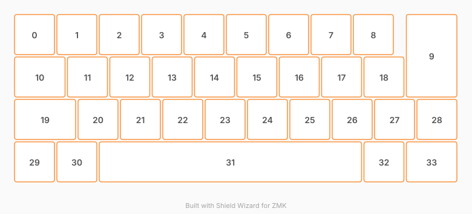

# ZMK Configuration for qaziso

*Generated by Shield Wizard for ZMK*



Download compiled firmware from the Actions tab. <https://zmk.dev/docs/user-setup#installing-the-firmware>

Edit your keymap <https://zmk.dev/docs/keymaps>.
User keymap is located at [`config/qaziso.keymap`](config/qaziso.keymap).

-----

<details>
<summary>
Shield Wizard Debug Information
</summary>

In case of broken configuration, here is the Shield Wizard internal data used to generate this configuration:

Commit: 84a348b08cf4fec4a5441a46147e9a345b10ffab

```json
{"name":"qaziso","shield":"qaziso","dongle":false,"modules":[],"layout":[{"id":"01M5AZNJD0X814Q4J9CNZA06XV","part":0,"row":0,"col":0,"w":1,"h":1,"x":0,"y":0,"r":0,"rx":0,"ry":0},{"id":"01M5AZNJD1G7SNPZAN7651YHS5","part":0,"row":0,"col":1,"w":1,"h":1,"x":1,"y":0,"r":0,"rx":0,"ry":0},{"id":"01M5AZNJD1W7HFVZTJV2DB78W2","part":0,"row":0,"col":2,"w":1,"h":1,"x":2,"y":0,"r":0,"rx":0,"ry":0},{"id":"01M5AZNJD1QKZGBGMQY2PSXJVB","part":0,"row":0,"col":3,"w":1,"h":1,"x":3,"y":0,"r":0,"rx":0,"ry":0},{"id":"01M5AZNJD1V8QTFMAGNW1NXJQE","part":0,"row":0,"col":4,"w":1,"h":1,"x":4,"y":0,"r":0,"rx":0,"ry":0},{"id":"01M5AZNJD1YSC1CGS2PAKQNKJT","part":0,"row":0,"col":5,"w":1,"h":1,"x":5,"y":0,"r":0,"rx":0,"ry":0},{"id":"01M5AZNJD15C2THT8GTND8XXSR","part":0,"row":0,"col":6,"w":1,"h":1,"x":6,"y":0,"r":0,"rx":0,"ry":0},{"id":"01M5AZNJD1YBMK22VK1BDRMF0M","part":0,"row":0,"col":7,"w":1,"h":1,"x":7,"y":0,"r":0,"rx":0,"ry":0},{"id":"01M5AZNJD1TA4X6YGY36CK3NAH","part":0,"row":0,"col":8,"w":1,"h":1,"x":8,"y":0,"r":0,"rx":0,"ry":0},{"id":"01M5AZNJD1EGW8C8WNYBHV65Q3","part":0,"row":0,"col":9,"w":1.25,"h":2,"x":9.25,"y":0,"r":0,"rx":0,"ry":0},{"id":"01M5AZNJD1ENHY693045SNKPJ5","part":0,"row":1,"col":0,"w":1.25,"h":1,"x":0,"y":1,"r":0,"rx":0,"ry":0},{"id":"01M5AZNJD1ZDS2N94Y48VBREJ0","part":0,"row":1,"col":1,"w":1,"h":1,"x":1.25,"y":1,"r":0,"rx":0,"ry":0},{"id":"01M5AZNJD168TZSQDDWW7KV2MA","part":0,"row":1,"col":2,"w":1,"h":1,"x":2.25,"y":1,"r":0,"rx":0,"ry":0},{"id":"01M5AZNJD1P178K7W5AG9NKM7N","part":0,"row":1,"col":3,"w":1,"h":1,"x":3.25,"y":1,"r":0,"rx":0,"ry":0},{"id":"01M5AZNJD1FZZXSKP817S2TGBD","part":0,"row":1,"col":4,"w":1,"h":1,"x":4.25,"y":1,"r":0,"rx":0,"ry":0},{"id":"01M5AZNJD1MYVJZNWSG8RJ13D3","part":0,"row":1,"col":5,"w":1,"h":1,"x":5.25,"y":1,"r":0,"rx":0,"ry":0},{"id":"01M5AZNJD1DCE9AYWN80Z5R4FR","part":0,"row":1,"col":6,"w":1,"h":1,"x":6.25,"y":1,"r":0,"rx":0,"ry":0},{"id":"01M5AZNJD1BS3JFJCZ7Z9RBZ1G","part":0,"row":1,"col":7,"w":1,"h":1,"x":7.25,"y":1,"r":0,"rx":0,"ry":0},{"id":"01M5AZNJD1HGBHMX7XM425C4DF","part":0,"row":1,"col":8,"w":1,"h":1,"x":8.25,"y":1,"r":0,"rx":0,"ry":0},{"id":"01M5AZNJD177XFEQETQZCR33MK","part":0,"row":2,"col":0,"w":1.5,"h":1,"x":0,"y":2,"r":0,"rx":0,"ry":0},{"id":"01M5AZNJD1M2ZN02N61HNWJK26","part":0,"row":2,"col":1,"w":1,"h":1,"x":1.5,"y":2,"r":0,"rx":0,"ry":0},{"id":"01M5AZNJD12HT1XKCJ1D01CE34","part":0,"row":2,"col":2,"w":1,"h":1,"x":2.5,"y":2,"r":0,"rx":0,"ry":0},{"id":"01M5AZNJD1SWQF6DRVSP08MRK1","part":0,"row":2,"col":3,"w":1,"h":1,"x":3.5,"y":2,"r":0,"rx":0,"ry":0},{"id":"01M5AZNJD1HXBC5G79WTCEJS7Q","part":0,"row":2,"col":4,"w":1,"h":1,"x":4.5,"y":2,"r":0,"rx":0,"ry":0},{"id":"01M5AZNJD1A95SPSSZDPFMD304","part":0,"row":2,"col":5,"w":1,"h":1,"x":5.5,"y":2,"r":0,"rx":0,"ry":0},{"id":"01M5AZNJD1C2KBQCVZZYR16C7J","part":0,"row":2,"col":6,"w":1,"h":1,"x":6.5,"y":2,"r":0,"rx":0,"ry":0},{"id":"01M5AZNJD10VQZ5GR5DVA4NW3K","part":0,"row":2,"col":7,"w":1,"h":1,"x":7.5,"y":2,"r":0,"rx":0,"ry":0},{"id":"01M5AZNJD1R2AE2BMX74V7Q5JZ","part":0,"row":2,"col":8,"w":1,"h":1,"x":8.5,"y":2,"r":0,"rx":0,"ry":0},{"id":"01M5AZNJD1GHNN2WTMF5097SD0","part":0,"row":2,"col":9,"w":1,"h":1,"x":9.5,"y":2,"r":0,"rx":0,"ry":0},{"id":"01M5AZNJD1WKJ5EFFNFF8ET324","part":0,"row":3,"col":0,"w":1,"h":1,"x":0,"y":3,"r":0,"rx":0,"ry":0},{"id":"01M5AZNJD18P0K4P15NFM6893J","part":0,"row":3,"col":1,"w":1,"h":1,"x":1,"y":3,"r":0,"rx":0,"ry":0},{"id":"01M5AZNJD1YHX2ZWJC0DS4MRRX","part":0,"row":3,"col":2,"w":6.25,"h":1,"x":2,"y":3,"r":0,"rx":0,"ry":0},{"id":"01M5AZNJD1VAJDA8ZKXXCAXKGJ","part":0,"row":3,"col":8,"w":1,"h":1,"x":8.25,"y":3,"r":0,"rx":0,"ry":0},{"id":"01M5AZNJD1RDMMXZFDGWFTZ4FR","part":0,"row":3,"col":9,"w":1.25,"h":1,"x":9.25,"y":3,"r":0,"rx":0,"ry":0}],"parts":[{"name":"unibody","controller":"nice_nano_v2","pins":{"d1":{"usage":"kscan","kscan":"01M5AZPJTETSKTZ8TCK5CXZDAD","role":"input"},"d0":{"usage":"kscan","kscan":"01M5AZPJTETSKTZ8TCK5CXZDAD","role":"input"},"d2":{"usage":"kscan","kscan":"01M5AZPJTETSKTZ8TCK5CXZDAD","role":"input"},"d3":{"usage":"kscan","kscan":"01M5AZPJTETSKTZ8TCK5CXZDAD","role":"input"},"d4":{"usage":"kscan","kscan":"01M5AZPJTETSKTZ8TCK5CXZDAD","role":"output"},"d5":{"usage":"kscan","kscan":"01M5AZPJTETSKTZ8TCK5CXZDAD","role":"output"},"d6":{"usage":"kscan","kscan":"01M5AZPJTETSKTZ8TCK5CXZDAD","role":"output"},"d7":{"usage":"kscan","kscan":"01M5AZPJTETSKTZ8TCK5CXZDAD","role":"output"},"d8":{"usage":"kscan","kscan":"01M5AZPJTETSKTZ8TCK5CXZDAD","role":"output"},"d9":{"usage":"kscan","kscan":"01M5AZPJTETSKTZ8TCK5CXZDAD","role":"output"},"d10":{"usage":"kscan","kscan":"01M5AZPJTETSKTZ8TCK5CXZDAD","role":"output"},"d16":{"usage":"kscan","kscan":"01M5AZPJTETSKTZ8TCK5CXZDAD","role":"output"},"d14":{"usage":"kscan","kscan":"01M5AZPJTETSKTZ8TCK5CXZDAD","role":"output"},"d15":{"usage":"kscan","kscan":"01M5AZPJTETSKTZ8TCK5CXZDAD","role":"output"}},"kscans":[{"kind":"matrix","id":"01M5AZPJTETSKTZ8TCK5CXZDAD","diodes":true}],"keys":{"01M5AZNJD0X814Q4J9CNZA06XV":{"input":"d1","output":"d4"},"01M5AZNJD1G7SNPZAN7651YHS5":{"input":"d1","output":"d5"},"01M5AZNJD1W7HFVZTJV2DB78W2":{"input":"d1","output":"d6"},"01M5AZNJD1QKZGBGMQY2PSXJVB":{"input":"d1","output":"d7"},"01M5AZNJD1V8QTFMAGNW1NXJQE":{"input":"d1","output":"d8"},"01M5AZNJD1YSC1CGS2PAKQNKJT":{"input":"d1","output":"d9"},"01M5AZNJD15C2THT8GTND8XXSR":{"input":"d1","output":"d10"},"01M5AZNJD1YBMK22VK1BDRMF0M":{"input":"d1","output":"d16"},"01M5AZNJD1TA4X6YGY36CK3NAH":{"input":"d1","output":"d14"},"01M5AZNJD1EGW8C8WNYBHV65Q3":{"input":"d1","output":"d15"},"01M5AZNJD1ENHY693045SNKPJ5":{"input":"d0","output":"d4"},"01M5AZNJD1ZDS2N94Y48VBREJ0":{"input":"d0","output":"d5"},"01M5AZNJD168TZSQDDWW7KV2MA":{"input":"d0","output":"d6"},"01M5AZNJD1P178K7W5AG9NKM7N":{"input":"d0","output":"d7"},"01M5AZNJD1FZZXSKP817S2TGBD":{"input":"d0","output":"d8"},"01M5AZNJD1MYVJZNWSG8RJ13D3":{"input":"d0","output":"d9"},"01M5AZNJD1DCE9AYWN80Z5R4FR":{"input":"d0","output":"d10"},"01M5AZNJD1BS3JFJCZ7Z9RBZ1G":{"input":"d0","output":"d16"},"01M5AZNJD1HGBHMX7XM425C4DF":{"input":"d0","output":"d14"},"01M5AZNJD177XFEQETQZCR33MK":{"input":"d2","output":"d4"},"01M5AZNJD1M2ZN02N61HNWJK26":{"input":"d2","output":"d5"},"01M5AZNJD12HT1XKCJ1D01CE34":{"input":"d2","output":"d6"},"01M5AZNJD1SWQF6DRVSP08MRK1":{"input":"d2","output":"d7"},"01M5AZNJD1HXBC5G79WTCEJS7Q":{"input":"d2","output":"d8"},"01M5AZNJD1A95SPSSZDPFMD304":{"input":"d2","output":"d9"},"01M5AZNJD1C2KBQCVZZYR16C7J":{"input":"d2","output":"d10"},"01M5AZNJD10VQZ5GR5DVA4NW3K":{"input":"d2","output":"d16"},"01M5AZNJD1R2AE2BMX74V7Q5JZ":{"input":"d2","output":"d14"},"01M5AZNJD1GHNN2WTMF5097SD0":{"input":"d2","output":"d15"},"01M5AZNJD1WKJ5EFFNFF8ET324":{"input":"d3","output":"d4"},"01M5AZNJD18P0K4P15NFM6893J":{"input":"d3","output":"d5"},"01M5AZNJD1YHX2ZWJC0DS4MRRX":{"input":"d3","output":"d8"},"01M5AZNJD1VAJDA8ZKXXCAXKGJ":{"input":"d3","output":"d14"},"01M5AZNJD1RDMMXZFDGWFTZ4FR":{"input":"d3","output":"d15"}},"encoders":[],"buses":{}}]}
```

</details>
